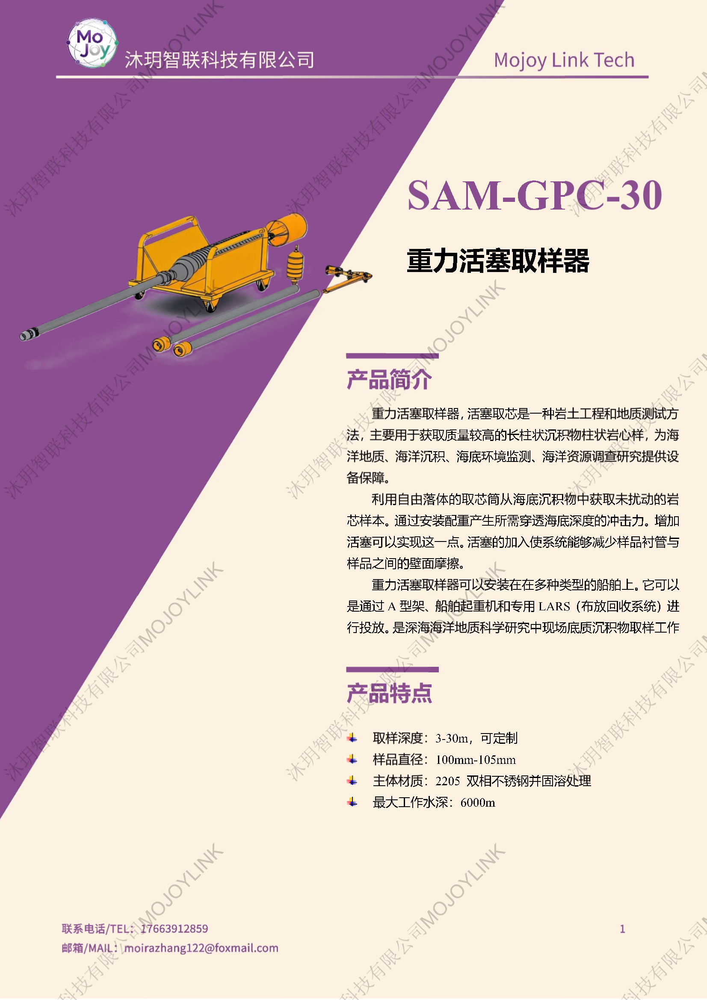
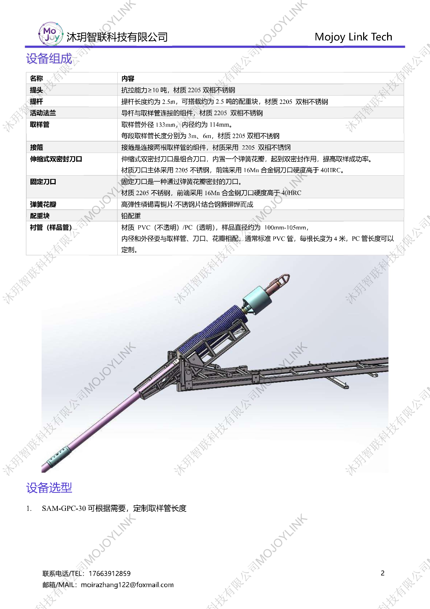

+++
title = "SAM-GPC-30 重力活塞取样器"
description = "SAM-GPC-30 重力活塞取样器系统主要用于获取质量较高的长柱状沉积物柱状岩心样，为海洋地质、海洋沉积、海底环境监测、海洋资源调查研究提供设备保障。"
summary = "SAM-GPC-30 重力活塞取样器系统主要用于获取质量较高的长柱状沉积物柱状岩心样，为海洋地质、海洋沉积、海底环境监测、海洋资源调查研究提供设备保障。"
date = "2026-08-04T10:00:00+08:00"
draft = false
tags = [ "海洋采样设备" ]
keywords = [
  "SAM-GPC-30",
  "重力活塞取样器",
  "深海沉积物取样器",
  "长柱状沉积物岩芯",
  "活塞负压取芯",
  "2205不锈钢重力柱",
  "6000m水深沉积物采样",
  "3-30m取芯长度"
]
+++

## 产品简介

重力活塞取样器，活塞取芯是一种岩土工程和地质测试方法，主要用于获取质量较高的长柱状沉积物柱状岩心样，为海洋地质、海洋沉积、海底环境监测、海洋资源调查研究提供设备保障。

利用自由落体的取芯筒从海底沉积物中获取未扰动的岩芯样本。通过安装配重产生所需穿透海底深度的冲击力。增加活塞可以实现这一点。活塞的加入使系统能够减少样品衬管与样品之间的壁面摩擦。

重力活塞取样器可以安装在在多种类型的船舶上。它可以是通过A型架、船舶起重机和专用LARS（布放回收系统）进行投放。是深海海洋地质科学研究中现场底质沉积物取样工作的一种重要技术装备研究。

## 产品特点

1. **取样深度：3-30 m**
   - 根据需求，采用多根 3m 或 6m 取样管拼接组合，连续长柱状沉积物岩芯，适配深海长序列沉积层序研究需求

2. **样品直径为 100-105 mm**
   - 标准取样管内径 Φ100-105mm，样品直径统一、横截面均匀，便于实验室分样与测试

3. **主体材质**
   - 2205 双相不锈钢并固溶处理

4. **最大工作水深 6000 m**
   - 主体结构与活塞系统针对深海高压工况设计，可在全球绝大多数深海海域开展沉积物作业，是远洋深海科考项目必备装备

## 设备组成

## 适用场景

1. **深海海洋地质与第四纪沉积学研究**：全球远洋深海海域 6000m 水深以内海底长柱状沉积物岩芯取样，开展层序地层、古气候古环境重建
2. **海洋环境监测**：国家/区域海洋污染监测基线调查，获取长柱样进行重金属、有机污染物等纵向分布研究
3. **海洋资源调查**：海底多金属结核、富钴结壳、砂矿等资源调查的沉积物采样
4. **高校海洋地质 / 海洋沉积学实验室**：教学实习科研院所（海洋一所、海洋二所、地调所相关高校海洋地质系）常规配备
5. **与 DDC-Z-3 / SAM-GC-9 柱状取样矩阵联动选型**：
   - 近海浅层 / 硬底质 / 砂质铁板砂场景 → DDC-Z-3（振动活塞）
   - 浅海 / 泥质 / 经济型 9m 长柱场景 → SAM-GC-9（纯重力柱）
   - 深海水深 / 科研级 30m 保真正交长柱场景 → SAM-GPC-30（重力活塞+负压）

  下载产品彩页

